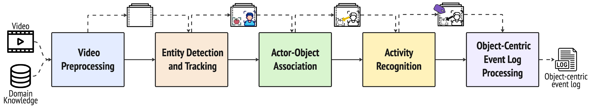

# ViOLET

This repository contains the code and resources for the master's thesis work "An Auto-Annotation Pipeline for Action Detection". It implements an offline, zero-shot auto-annotation pipeline that processes raw videos to produce annotations for human actions and object interactions, and object-centric event logs for process mining.

## Evaluation branches

- `main` contains the shared pipeline and the TUM Kitchen evaluation code under `evaluation/TUMKitchen/`.
- `eval/ground` contains the Ground-specific pipeline configuration and evaluation, including its [instructions](https://github.com/strong-ms/ViOLET/blob/eval/ground/evaluation/Ground/README.md), notebooks, scripts, and results.

For the Ground evaluation, check out `eval/ground` and follow its instructions. Use `main` for the TUM Kitchen evaluation. The Ground branch changes dataset paths, action labels, and the recognition prompt; running the `main` action-labeling notebook does not reproduce Ground results. A paper release should identify the exact commit of each branch used for the reported results.

## Pipeline Architecture

[](assets/pipeline.png)

*Figure: High-level ViOLET pipeline. The implementation also runs person-object association before activity recognition to provide object context.*

The pipeline consists of the following sequential stages:
1. **Data Pre-processing**: Raw videos are segmented based on shot changes, and 30 Frames Per Second (FPS) are extracted. Unsuitable or blurry clips are discarded using the VGGT model.
2. **Object Detection and Tracking**: The pipeline uses Detectron2 to detect human actors and GroundingDINO to detect objects. SAM2 is then utilized to track these detections across temporal windows.
3. **Person–Object Association**: A standalone geometric stage associates tracked objects with people using bounding-box containment, proximity, and temporal consistency. The output preserves frame-level evidence and window-level associations without modifying the detection results.
4. **Action Recognition**: The Qwen3-VL-8B-Instruct model (loaded in 4-bit precision) assigns action labels to the tracked humans and uses only the objects associated with the target actor.
5. **Output Production**: The processed data is formatted into event logs suitable for process mining applications, including object-centric event logs.

## Technical details: detection and evaluation

The detection notebook consolidates GroundingDINO boxes returned for different text prompts. For boxes $A$ and $B$, intersection over union is $\operatorname{IoU}(A,B)=|A\cap B|/|A\cup B|$. Candidates are sorted by confidence; class-aware non-maximum suppression (NMS) keeps the highest-scoring box and discards a later box of the same class when their IoU exceeds **0.45**. A subsequent filter retains scores of at least **0.15** and removes detections whose IoU with a retained box exceeds **0.45**, or same-class detections whose box centers are less than **50 pixels** apart. Finally, a smaller same-class box is removed when more than **80% of its area** lies inside a retained larger box. The second filter's IoU check is independent of class, unlike the initial NMS step.

The cross-prompt NMS step is implemented as this confidence-ordered greedy procedure:

```text
kept = []
for candidate in sort_by_confidence_descending(raw_candidates):
    if any(candidate.class == box.class and
           IoU(candidate.box, box.box) > 0.45 for box in kept):
        continue
    kept.append(candidate)
```

The threshold comparison is strict (`> 0.45`), so boxes with IoU exactly 0.45 are retained. The later confidence, center-distance, and containment checks are separate passes; see [`obj_det_w_dino.ipynb`](data_pipeline/jupiter_notebooks/obj_det_w_dino.ipynb) for the executable implementation.

For activity class $c$, evaluation counts true positives $TP_c$, false positives $FP_c$, and false negatives $FN_c$ over annotated frames. Precision is $P_c=TP_c/(TP_c+FP_c)$, recall is $R_c=TP_c/(TP_c+FN_c)$, and $F1_c=2P_cR_c/(P_c+R_c)$; undefined ratios are scored as zero. Macro-F1 averages $F1_c$ equally over classes, whereas micro-F1 first sums the three counts over classes and then computes F1. Ground evaluation also reports support-weighted F1, $\sum_c n_c F1_c/\sum_c n_c$, where $n_c$ is the number of ground-truth frames for class $c$.

TUM Kitchen permits multiple labels per frame. For true and predicted label sets $Y_t$ and $\hat Y_t$, subset accuracy averages $\mathbf{1}[Y_t=\hat Y_t]$, and Jaccard similarity averages $|Y_t\cap\hat Y_t|/|Y_t\cup\hat Y_t|$; an empty union scores one. Sequence evaluation collapses consecutive repeated activities and reports normalized edit similarity $1-d_{edit}(\sigma_{gt},\sigma_{pred})/\max(|\sigma_{gt}|,|\sigma_{pred}|)$, with two empty sequences scoring one. Where available, longest-common-subsequence (LCS) precision and recall divide the LCS length by the predicted and reference sequence lengths, respectively; LCS-F1 is their harmonic mean.

## Repository Structure

The repository is organized into three main directories:

*   **`data_pipeline/`**: Contains utility files and model weights intended to be loaded onto Google Drive. 
    *   Must contain a manually created **`DATA_ROOT/`** folder where the raw input videos will be placed.
    *   **`jupiter_notebooks/`**: Contains the execution flow of the pipeline:
        *   `pre_processing.ipynb`: Handles video cropping and frame extraction.
        *   `obj_det_w_dino.ipynb`: Executes human/object detection and SAM2 tracking.
        *   `person_object_association.ipynb`: Associates tracked objects with people from the detection JSON files; it does not rerun detection or tracking.
        *   `action_labeling.ipynb`: Runs the Qwen3-VL action recognition inference.
        *   `process_mining_formatting.ipynb`: Adapts the pipeline output into event logs for process mining tasks.
        *   `convert_log.ipynb`: Converts event logs for downstream process mining analysis.
*   **`evaluation/`**: Contains the TUM Kitchen validation on `main`. On `eval/ground`, it also contains the Ground activity recognition evaluation, object-centric event-log exporter, temporal entity consistency notebook, and saved results.

## Environment and Execution

The entire workflow has been designed and tested on **Google Colab**, utilizing Google Drive for storage and file management. 

To run the pipeline for the [TUM Kitchen Dataset](https://ias.uni-bremen.de/ias/research/software/kitchen-activity-data):
1. Clone this repository into your Google Drive environment.
2. Create the `DATA_ROOT` directory inside `data_pipeline/` and upload the dataset.
3. Open the files in `data_pipeline/jupiter_notebooks/` using Google Colab.
4. Execute the notebooks sequentially following the pipeline architecture (Pre-processing -> Object Detection -> Person–Object Association -> Action Labeling -> Process Mining Formatting).

For Ground, switch to `eval/ground` first. Follow the [Ground evaluation guide](https://github.com/strong-ms/ViOLET/blob/eval/ground/evaluation/Ground/README.md) for its input archives, Ground-specific notebook settings, evaluation notebook, and event-log outputs. The action-recognition and temporal-consistency evaluations are separate from the sequential generation pipeline.

The association stage can also be run without Jupyter:

```bash
python data_pipeline/person_object_association.py \
  data_pipeline/DATA_ROOT/video_general_obj_det_finished \
  data_pipeline/DATA_ROOT/person_object_associations
```

The scoring method and JSON contracts are documented in [`docs/person_object_association_spec.md`](docs/person_object_association_spec.md).

The final cell of `person_object_association.ipynb` generates sampled diagnostic frames under `DATA_ROOT/person_object_association_visualizations/`. People are drawn in red, temporally accepted objects in green, and each accepted association is represented by a yellow line and its frame-level score. The visualization step never modifies the original frames.

## Main External References
```
@inproceedings{DBLP:conf/icra/DeigmoellerAHTBGWOZDG26,
  author={Joerg Deigmoeller and Nakul Agarwal and Stephan Hasler and Daniel Tanneberg and Anna Belardinelli and Reza Ghoddoosian and Chao Wang and Felix Ocker and Fan Zhang and Behzad Dariush and Michael Gienger},
  title={{MERGE:} Guided Vision-Language Models for Multi-Actor Event Reasoning and Grounding in Human-Robot Interaction},
  booktitle={{IEEE} International Conference on Robotics and Automation},
  pages={2465--2472},
  year={2026}
}
```

```
@article{foundationmotion,
  author={Yulu Gan and Ligeng Zhu and Dandan Shan and Baifeng Shi and Hongxu Yin and Boris Ivanovic and Song Han and Trevor Darrell and Jitendra Malik and Marco Pavone and Boyi Li},
  title={FoundationMotion: Auto-Labeling and Reasoning about Spatial Movement in Videos},
  journal={CoRR},
  volume={abs/2512.10927},
  year={2025}
}
```

```
@inproceedings{tumdataset,
  title={The TUM kitchen data set of everyday manipulation activities for motion tracking and action recognition},
  author={Tenorth, Moritz and Bandouch, Jan and Beetz, Michael},
  booktitle={2009 IEEE 12th International Conference on Computer Vision Workshops, ICCV Workshops},
  pages={1089--1096},
  year={2009},
  organization={IEEE}
}
```
